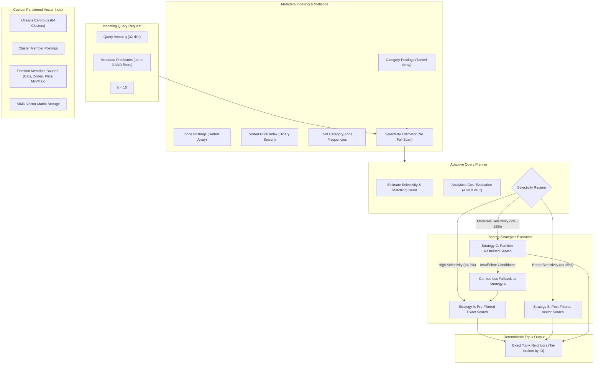

# Madurai Pincode Search: System Architecture & Design

## 1. Executive Overview

**The Madurai Pincode Search** engine is an adaptive hybrid vector search system that pairs high-dimensional vector similarity search with structured metadata filtering. Rather than forcing every query into a rigid execution model, the engine employs an **Adaptive Query Planner** that dynamically estimates filter selectivity in $O(1)$ to $O(\log N)$ time and routes queries among three distinct retrieval strategies:

1. **Strategy A (Pre-Filtered Exact Search)**: Inverted postings prune non-matching records first; exact vector distances are computed only for qualified candidates.
2. **Strategy B (Post-Filtered Vector Search)**: Probes nearest vector partitions in embedding space, then filters candidates against metadata predicates.
3. **Strategy C (Partition-Restricted Search)**: Uses per-partition metadata bounds (category sets, zone sets, price ranges) to eliminate non-qualifying partitions before ranking centroid proximity.

Ground truth is computed via exact brute-force search over all eligible records with deterministic tie-breaking by record ID.

---

## 2. Architecture Diagram

---

## 3. Metadata Index Design

The metadata index supports four query predicate types:
1. `category == value`
2. `zone == value`
3. `min_price <= price <= max_price`
4. AND combinations of any supported predicates (up to 3).

### Representations & Trade-Offs
- **Postings Lists**: Stored as contiguous sorted `numpy.ndarray[int32]`. Intersections use C-level SIMD routines via `np.intersect1d`, enabling multi-predicate intersections in sub-millisecond time.
- **Price Index**: Stores parallel arrays `sorted_prices` (float32) and `sorted_price_ids` (int32). Range queries use `np.searchsorted` to locate boundaries in $O(\log N)$ steps without allocating large intermediate structures.
- **Joint Frequency Matrix**: Precomputes cross-tabulation of category and zone frequencies to provide exact joint probabilities for two-predicate filters without sampling or data scans.
- **Selectivity Estimation**:
  $$\hat{s} = \frac{\hat{N}_{eligible}}{N_{active}}$$
  Where $\hat{N}_{eligible}$ is derived analytically:
  $$\hat{N}_{eligible} = \text{JointCount}(cat, zone) \times \frac{\text{PriceRank}(max\_p) - \text{PriceRank}(min\_p)}{N_{active}}$$

---

## 4. Custom Vector Index Design

The custom partitioned vector index is built without third-party vector databases or ANN libraries (FAISS, hnswlib, Annoy, etc.).

### Components
1. **Centroids**: 64 centroids initialized via scikit-learn's `KMeans` during index construction.
2. **Partition Postings**: Each cluster maintains a sorted array of assigned record IDs.
3. **Partition Metadata Bounds**:
   - `categories`: `Set[str]` of all categories present in the cluster.
   - `zones`: `Set[str]` of all zones present in the cluster.
   - `min_price`, `max_price`: Float bounds of member prices.
4. **Vector Storage**: Contiguous 2D matrix of shape `(max_id + 1, 32)` aligned for fast row-slicing and vectorized Euclidean distance computation.

### Distance Definition
Vector similarity uses Euclidean distance ($L_2$ norm):
$$d(u, v) = \sqrt{\sum_{i=1}^{D} (u_i - v_i)^2}$$
Vectorized matrix distance computes row-wise dot products via NumPy's BLAS operations:
$$d(q, X)_j = \sqrt{\|X_j - q\|_2^2}$$

---

## 5. Strategy Implementation Details

| Strategy | When Chosen | Strengths | Trade-Offs / Risks |
| :--- | :--- | :--- | :--- |
| **Strategy A (Pre-Filter)** | Selective queries ($\hat{s} \le 2\%$) or small eligible count ($\le 300$). | Exact 100% recall; zero cluster search overhead. | High latency if query is broad ($N_{elig} > 15,000$). |
| **Strategy B (Post-Filter)** | Broad queries ($\hat{s} \ge 35\%$) or unconstrained searches. | Extremely fast; probes only nearest clusters; minimal candidate work. | Low recall if used on selective queries with fixed candidate budget. |
| **Strategy C (Partition-Restricted)** | Moderate selectivity ($2\% < \hat{s} < 35\%$). | Prunes non-matching clusters using member metadata bounds; visits only viable partitions. | Sensitive to partition scatter; requires correctness fallback when matches are insufficient. |

---

## 6. Correctness Fallback & Determinism

- **Deterministic Tie-Breaking**: When two candidates have identical distance, ties are broken deterministically by ascending integer record ID.
- **Correctness-Preserving Fallback**: Strategy C tracks the number of viable matches found. If fewer than $k$ matches are gathered after visiting candidate partitions, an automatic fallback to Strategy A is executed to guarantee Recall@10 $\ge 0.95$.
